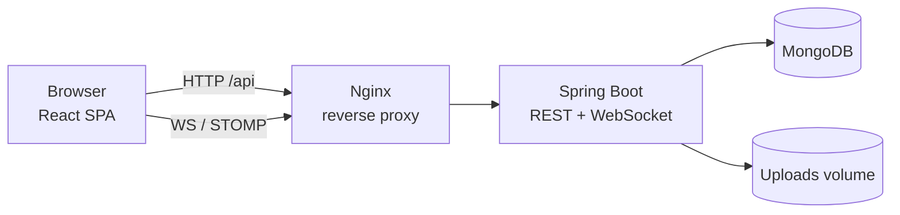

<div align="center">

# 💬 EchoRoom

### Real-time, room-based chat with owner-approval access control

A self-hostable chat platform featuring JWT-secured messaging over WebSocket/STOMP, private rooms gated by owner approval, and a built-in admin dashboard.


[Quick Start](#-quick-start) · [Features](#-features) · [Architecture](#-architecture) · [Configuration](#-configuration) · [Production Checklist](#-production-checklist)

</div>

---

## 📖 Overview

**EchoRoom** is a full-stack chat application built around **controlled, room-based collaboration**. Anyone can create a room, but joining requires the owner's approval, and every REST call and WebSocket connection is authenticated server-side.

> Implemented per the project synopsis · **Project ID: Cs3I_09**

## ✨ Features

| Category | Capabilities |
|---|---|
| 🔐 **Access Control** | Owner-approval rooms, live join-request notifications, approve/deny workflow |
| ⚡ **Real-Time Messaging** | WebSocket over STOMP, instant broadcast to room subscribers |
| 👀 **Presence & Awareness** | Typing indicators, online presence, read receipts |
| 😀 **Rich Interaction** | Message reactions, edit, and delete (sender edits; sender or room owner deletes) |
| 📎 **File Sharing** | Image/file uploads with extension and size validation |
| 🛡️ **Security** | JWT auth (JJWT), BCrypt password hashing, server-derived identity on every handler |
| 🧭 **Admin Dashboard** | Room statistics and room closure, restricted to `ADMIN` role |
| 🐳 **Deployment** | One-command Docker Compose stack (MongoDB + backend + frontend) |

## 🧱 Tech Stack

| Layer | Technology |
|---|---|
| **Frontend** | React 18, Vite, Tailwind CSS, `@stomp/stompjs`, axios |
| **Backend** | Java 17, Spring Boot 3.4.1, Spring Security, Spring WebSocket |
| **Database** | MongoDB 5.0 |
| **Real-time** | WebSocket with the STOMP sub-protocol |
| **Auth** | JWT (JJWT) + BCrypt |
| **Containers** | Docker, Docker Compose |

## 🏗️ Architecture



### Project Layout

```
echoroom-app/
├── backend/                  Spring Boot REST + WebSocket API
│   ├── src/main/java/com/echoroom/
│   │   ├── config/           Security, WebSocket, CORS, admin bootstrap
│   │   ├── security/         JWT util, REST filter, STOMP auth interceptor
│   │   ├── model/            User, Room, Message (MongoDB documents)
│   │   ├── repository/       Spring Data MongoDB repositories
│   │   ├── dto/              Request/response payloads
│   │   ├── service/          Business logic (users, rooms, chat, admin)
│   │   ├── controller/       REST + STOMP (@MessageMapping) endpoints
│   │   └── exception/        Centralized error handling
│   ├── src/main/resources/application.yml
│   ├── pom.xml
│   └── Dockerfile
├── frontend/                 React SPA
│   ├── src/
│   │   ├── api/              axios client (attaches JWT automatically)
│   │   ├── context/          AuthContext (login/register/logout)
│   │   ├── socket/           STOMP client wrapper
│   │   ├── pages/            Login, Register, Rooms, ChatRoom, AdminDashboard
│   │   └── components/       NavBar, Avatar, MessageBubble, TypingIndicator, JoinRequests
│   ├── nginx.conf            Production reverse proxy (API + WS)
│   ├── vite.config.js / tailwind.config.js
│   └── Dockerfile
└── docker-compose.yml        Orchestrates mongo + backend + frontend
```

### How Features Map to Code

| Feature | Implementation |
|---|---|
| Owner-approval rooms | `RoomService.requestJoin / approveJoin / denyJoin`, pushed live to the owner via `/user/queue/room-events` and rendered in `JoinRequests.jsx` |
| Real-time messaging | `ChatController` (`@MessageMapping("/room/{roomId}/send")`) broadcasts to `/topic/room/{roomId}`; subscribed in `ChatRoom.jsx` |
| Typing, presence, read receipts | `/topic/room/{roomId}/typing`, `/topic/room/{roomId}/presence`, and `ChatService.markRead` |
| Reactions, edit, delete | `ChatService` with matching STOMP handlers |
| Identity & access security | `JwtAuthFilter` (REST) and `StompAuthChannelInterceptor` (STOMP CONNECT); handlers use the server-derived `Principal`, never a client-supplied username |
| Admin dashboard | `AdminController` / `AdminService`, gated by `hasRole("ADMIN")` in `SecurityConfig`, rendered in `AdminDashboard.jsx` |
| File & image sharing | `FileController` validates extension/size and stores to a Docker volume; messages reference the returned `/uploads/...` URL |

## 🚀 Quick Start

### Option A: Docker Compose (recommended)

**Prerequisites:** Docker and Docker Compose.

```bash
cd echoroom-app
docker compose up --build
```

| Service | URL |
|---|---|
| Frontend | http://localhost |
| Backend API | http://localhost:8080/api |
| MongoDB | `localhost:27017` (container-internal for the app) |

On first boot, the backend bootstraps an administrator account:

| Username | Password |
|---|---|
| `admin` | `admin123` |

> [!CAUTION]
> These are **development defaults only**. Override them before the first run, and set a strong `JWT_SECRET` for anything beyond local testing.

Create a `.env` file at the repo root, next to `docker-compose.yml`:

```bash
JWT_SECRET=replace-with-a-long-random-string
ADMIN_USERNAME=youradminname
ADMIN_PASSWORD=a-strong-password
```

Log in as the admin and open **Admin Dashboard** from the navbar to view room stats and close rooms.

### Option B: Run Locally (without Docker)

**Prerequisites:** JDK 17, Maven, Node.js, and a MongoDB instance.

**1. Database**

Run MongoDB at `mongodb://localhost:27017/echoroom`, or point `MONGO_URI` at any reachable instance (e.g. MongoDB Atlas).

**2. Backend**

```bash
cd backend
mvn spring-boot:run
```

The API starts at `http://localhost:8080`.

**3. Frontend**

```bash
cd frontend
cp .env.example .env      # points at http://localhost:8080
npm install
npm run dev
```

Open `http://localhost:5173`.

## ⚙️ Configuration

All variables are optional, with sensible defaults in `application.yml`.

| Variable | Purpose |
|---|---|
| `MONGO_URI` | MongoDB connection string |
| `JWT_SECRET` | Signing key for JWTs. **Must be long and random in production** |
| `JWT_EXPIRATION_MS` | Token lifetime in milliseconds |
| `CORS_ORIGINS` | Allowed browser origins |
| `ADMIN_USERNAME` | Bootstrap admin username |
| `ADMIN_PASSWORD` | Bootstrap admin password |
| `UPLOAD_DIR` | File upload storage directory |

## 🔌 WebSocket Destinations

| Destination | Direction | Purpose |
|---|---|---|
| `/app/room/{roomId}/send` | Client → Server | Send a message |
| `/topic/room/{roomId}` | Server → Clients | Room message broadcast |
| `/topic/room/{roomId}/typing` | Both | Typing indicators |
| `/topic/room/{roomId}/presence` | Server → Clients | Presence updates |
| `/user/queue/room-events` | Server → Owner | Live join requests |

## ✅ Production Checklist

- [ ] Change `ADMIN_USERNAME` and `ADMIN_PASSWORD` from the defaults
- [ ] Set a long, random `JWT_SECRET`
- [ ] Terminate TLS in front of the `frontend` nginx container and serve over **HTTPS/WSS**
- [ ] Restrict `CORS_ORIGINS` to your real domain(s)
- [ ] Add rate limiting on `/api/auth/**` and `/api/files/upload`
- [ ] Back up the MongoDB data and uploads volumes
- [ ] Run `mvn -q verify` and `npm run build` in CI before each deploy

## 🗺️ Roadmap

- **Message storage at scale:** move high-volume rooms from embedded `Room.messages` arrays to a dedicated `messages` collection with pagination. The current design favors simplicity for typical room sizes.
- **Abuse protection:** built-in rate limiting for auth and upload endpoints.

## ⚠️ Build Status

This codebase has been carefully reviewed but **not build-verified** in a live Maven/npm environment. Run `mvn -q verify` and `npm run build` locally before deploying, and resolve any issues that surface.

## 🤝 Contributing

Contributions are welcome.

1. Fork the repository
2. Create a feature branch: `git checkout -b feature/your-feature`
3. Commit your changes: `git commit -m "Add your feature"`
4. Push the branch: `git push origin feature/your-feature`
5. Open a Pull Request

## 📄 License

Add a `LICENSE` file and update this section with your chosen license.

---

<div align="center">

**Built with Spring Boot, React, and MongoDB**

</div>
